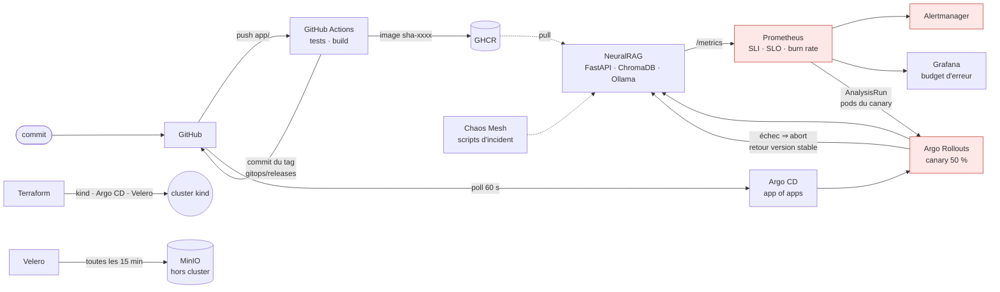

# Plateforme GitOps auto-réparatrice — SLO, réponse à incident et reprise après sinistre

Une plateforme Kubernetes locale qui déploie **NeuralRAG** (API RAG FastAPI + ChromaDB + Ollama)
uniquement depuis Git, surveille deux SLO, **annule automatiquement une mauvaise version** et
**se restaure après la perte complète du cluster**. Chaque chiffre ci-dessous est produit par un
script et stocké dans [`results/`](results/).

**Outils** : Terraform · Kubernetes (kind) · Argo CD · Argo Rollouts · Helm · Prometheus ·
Alertmanager · Grafana · Velero · MinIO · Chaos Mesh · k6 · GitHub Actions · GHCR

## Résultats

<!-- RESULTS:START -->
| Mesure | Résultat | Source |
| --- | --- | --- |
| Temps de rollback (détection → version saine) | _pas encore mesuré_ | [`results/rollback/`](results/rollback/) |
| Temps total (commit fautif → version saine) | _pas encore mesuré_ | [`results/rollback/`](results/rollback/) |
| SLO tenus sous charge (k6, 30 min) | _pas encore mesuré_ | [`results/slo/`](results/slo/) |
| Incidents détectés par une alerte | _pas encore mesuré_ | [`results/alerts/`](results/alerts/) |
| Fausses alertes sur trafic normal | _pas encore mesuré_ | [`results/alerts/`](results/alerts/) |
| RTO (cluster détruit → service rétabli) | _pas encore mesuré_ | [`results/dr/`](results/dr/) |
| RPO (données perdues) | _pas encore mesuré_ | [`results/dr/`](results/dr/) |
<!-- RESULTS:END -->

Tableau régénéré par `make results` à partir des fichiers `results/*/summary.json`.

## Architecture

Deux boucles : **livraison** (Git → CI → registre → Argo CD → cluster) et **réparation**
(métriques → SLO → analyse/alerte → rollback). Terraform crée le cluster, Velero le sauvegarde
hors du cluster.



Décisions détaillées dans [`docs/adr/`](docs/adr/) :
[Argo CD](docs/adr/0001-argo-cd-pour-le-gitops.md) ·
[Argo Rollouts](docs/adr/0002-argo-rollouts-pour-le-rollback.md) ·
[SLO et burn rates](docs/adr/0003-fenetre-slo-et-burn-rates.md) ·
[sauvegarde et restauration](docs/adr/0004-sauvegarde-hors-cluster-et-ordre-de-restauration.md) ·
[releases défaillantes simulées](docs/adr/0005-simulation-des-releases-defaillantes.md)

## SLO

| SLO | SLI | Cible (7 j) | Alerte page | Alerte ticket |
| --- | --- | --- | --- | --- |
| Disponibilité | requêtes API non 5xx | 99,5 % | burn rate > 3,36 sur 1 h **et** 5 min | > 1,4 sur 6 h **et** 30 min |
| Latence | requêtes API ≤ 10 s (p95 ≤ 10 s) | 95 % | idem | idem |

Plus deux alertes symptômes : `NeuralRAGBackendDown` (aucune pod ne sert) et
`NeuralRAGRolloutAborted` (une release vient d'être annulée). Règles :
[`gitops/observability/slo-rules.yaml`](gitops/observability/slo-rules.yaml), testées par
`promtool` ([`tests/prometheus/`](tests/prometheus/)). Que faire pour chaque alerte :
[`docs/runbook.md`](docs/runbook.md).

## Démarrage

Prérequis (Linux, ou VM Kali / WSL2) : Docker, Terraform ≥ 1.6, kubectl, git, python3, make.
8 Go de RAM minimum, 12 Go conseillés. Optionnels : helm, plugin `kubectl argo rollouts`.

```bash
make up          # cluster kind + MinIO + Argo CD + Velero ; Argo CD synchronise le reste (~10 min)
make status      # applications Argo CD, rollout, pods
make urls        # NeuralRAG :8080/docs · Grafana :3000 · Prometheus :9090 · Alertmanager :9093 · Argo CD :8443
make secrets     # clé API et mot de passe Grafana (générés par Terraform, jamais dans Git)
make seed        # indexe les documents d'exemple une fois
make down        # supprime tout
```

### Première mise en route (une seule fois)

1. `sudo ./scripts/install-prereqs.sh` (Debian/Ubuntu/Kali), puis se reconnecter.
2. Créer le dépôt public `gitops-self-healing-platform` sur GitHub et y pousser ce code
   (Argo CD lit ce dépôt ; l'URL est dans `gitops/apps/` et `infra/terraform/platform/variables.tf`).
3. Attendre la fin du workflow **release** (onglet *Actions*) : il publie
   `ghcr.io/<compte>/neuralrag-backend` et commite le tag dans `gitops/releases/neuralrag.yaml`.
4. Sur GitHub → *Packages* → `neuralrag-backend` → *Package settings* → visibilité **Public**
   (le cluster tire l'image sans identifiants).
5. `git pull`, puis `make up`, `make status` jusqu'à ce que tout soit *Healthy*, puis `make seed`.
6. Mesure de base : `DURATION=10m make exp-slo`. Si plus de 5 % des requêtes dépassent 10 s
   sur la machine, ajuster le seuil (une borne de `metrics/sli.py`, par ex. `15.0`) dans
   `gitops/observability/slo-rules.yaml`, `charts/neuralrag/values.yaml` (`slo.latencyThresholdLe`)
   et `tests/prometheus/`, ou réduire `ollama.numPredict`.

Livrer une nouvelle version : modifier `app/`, pousser sur `main`. Le workflow `release`
teste, construit l'image, la publie sur GHCR puis **commite le nouveau tag** dans
`gitops/releases/neuralrag.yaml` ; Argo CD et Argo Rollouts font le reste.

## Mesures

| Commande | Ce qui est mesuré | Critère d'acceptation |
| --- | --- | --- |
| `make exp-rollback` | 10 releases défaillantes (erreurs, latence, crash) poussées dans Git | rollback réussi sur toutes ; médiane et max publiés |
| `make exp-slo` | test de charge k6 de 30 min sur la version saine | disponibilité et latence dans les cibles |
| `make exp-alerts` | 3 incidents Chaos Mesh (perte de ChromaDB, latence réseau, pods en panne) | chaque incident déclenche son alerte |
| `make exp-false-positives` | 24 h de trafic normal (générateur intégré) | 0 alerte |
| `make exp-dr` | destruction du cluster par Terraform, restauration Velero | service rétabli, documents présents, RTO et RPO publiés |
| `make postmortems` | un brouillon de postmortem par incident simulé | [`docs/postmortems/`](docs/postmortems/) |

Les releases défaillantes sont des **commits** qui activent une faute dans la configuration
de la release (voir [ADR 0005](docs/adr/0005-simulation-des-releases-defaillantes.md)) : elles
suivent exactement le chemin GitOps d'une vraie release.

## Dépannage

| Symptôme | Piste |
| --- | --- |
| Pods `ImagePullBackOff` sur `neuralrag-backend` | paquet GHCR encore privé, ou workflow *release* pas encore passé |
| Pods qui redémarrent, « too many open files » | limites inotify : relancer `scripts/install-prereqs.sh` |
| Pods `Pending` / `OOMKilled` | RAM de la VM : passer à 12 Go, ou `backend.replicas: 1` (le canary passe alors à 100 %) |
| `BackupStorageLocation` *Unavailable* (`kubectl -n velero get bsl`) | le pod Velero ne résout pas `selfheal-minio` : remplacer par l'IP du conteneur (`docker inspect selfheal-minio`) dans `values/velero.yaml.tftpl` |
| Applications Argo CD bloquées en *Progressing* | `kubectl -n argocd get applications` puis l'UI Argo CD (http://localhost:8443, utilisateur `admin`, mot de passe : `kubectl -n argocd get secret argocd-initial-admin-secret -o jsonpath='{.data.password}' \| base64 -d`) |

## Correspondance avec le cahier des charges

| Exigence | Où |
| --- | --- |
| EF-01 cluster en une commande | [`infra/terraform/cluster/`](infra/terraform/cluster/), `make up` / `make down` |
| EF-02 briques déclaratives | [`infra/terraform/platform/`](infra/terraform/platform/), [`gitops/apps/`](gitops/apps/) (app of apps) |
| EF-03 build, test, publication | [`.github/workflows/`](.github/workflows/) |
| EF-04 déploiement depuis Git | [`gitops/apps/30-neuralrag.yaml`](gitops/apps/30-neuralrag.yaml), [`charts/neuralrag/`](charts/neuralrag/) |
| EF-05 métriques de l'API | [`app/backend/metrics/sli.py`](app/backend/metrics/sli.py) |
| EF-06, EF-07 SLO et burn rate | [`gitops/observability/slo-rules.yaml`](gitops/observability/slo-rules.yaml) |
| EF-08 tableau de bord | [`gitops/observability/dashboard-slo.yaml`](gitops/observability/dashboard-slo.yaml) (généré) |
| EF-09 rollback automatique | [`charts/neuralrag/templates/`](charts/neuralrag/templates/) (Rollout + AnalysisTemplate) |
| EF-10 incidents reproductibles | [`app/backend/chaos.py`](app/backend/chaos.py), [`incidents/`](incidents/) |
| EF-11 postmortems | [`docs/postmortems/`](docs/postmortems/) |
| EF-12 sauvegardes | [`infra/terraform/cluster/minio.tf`](infra/terraform/cluster/minio.tf), Velero dans `platform/` |
| EF-13 destruction / restauration | [`scripts/experiments/dr_drill.py`](scripts/experiments/dr_drill.py) |
| EF-14 à EF-16 (lot 3, sécurité) | à venir (tag v1.0.0) |

## Structure

```
app/                  NeuralRAG (backend repris de rag-devops-pfa) + middlewares SLI et chaos
charts/neuralrag/     chart Helm : Rollout, AnalysisTemplate, ChromaDB, Ollama, générateur de trafic
gitops/apps/          Applications Argo CD (app of apps)
gitops/releases/      release désirée : tag d'image, fautes injectées
gitops/observability/ règles SLO, alertes, tableau de bord Grafana
infra/terraform/      cluster (kind + MinIO) et plateforme (Argo CD, Velero, app racine)
incidents/            incidents Chaos Mesh
scripts/experiments/  scripts de mesure → results/
docs/                 ADR, runbook, postmortems
```

## Origine

L'application est [NeuralRAG (rag-devops-pfa)](https://github.com/Rihemfathallah/rag-devops-pfa),
reprise sans modification fonctionnelle : ajout des métriques SLI, d'un middleware de faute
désactivé par défaut et d'une image non root. Les notions de SLO, budget d'erreur et
postmortem sans reproche viennent de [Site Reliability Engineering](https://sre.google/sre-book/table-of-contents/)
(Google).

Hors périmètre : agent LLM de diagnostic (projet NOC Copilot), multi-cluster, cloud payant,
service mesh.
